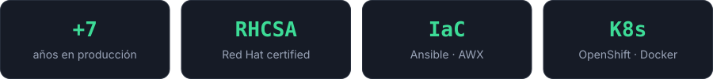

<div align="center">

<a href="https://joan-camps-ciria.github.io/"><picture><source media="(prefers-color-scheme: dark)" srcset="assets/hero-dark.svg"><source media="(prefers-color-scheme: light)" srcset="assets/hero-light.svg"></picture></a>

<a href="https://joan-camps-ciria.github.io/"><picture><source media="(prefers-color-scheme: dark)" srcset="assets/boton-portfolio-dark.svg"><source media="(prefers-color-scheme: light)" srcset="assets/boton-portfolio-light.svg"></picture></a>
<a href="https://www.linkedin.com/in/joan-camps-ciria/"><picture><source media="(prefers-color-scheme: dark)" srcset="assets/boton-linkedin-dark.svg"><source media="(prefers-color-scheme: light)" srcset="assets/boton-linkedin-light.svg"></picture></a>

<a href="https://joan-camps-ciria.github.io/"><picture><source media="(prefers-color-scheme: dark)" srcset="assets/cifras-dark.svg"><source media="(prefers-color-scheme: light)" srcset="assets/cifras-light.svg"></picture></a>

</div>

## `01.` kubectl describe joan

```yaml
apiVersion: humano/v1
kind: Ingeniero
metadata:
  name: joan-camps-ciria
  labels:
    modo: aprender-haciendo
spec:
  replicas: 1            # aún no escalo horizontalmente
  rol: Linux Systems Engineer
  enfoque: [Linux, automatización, contenedores]
  aprendiendo: Terraform
  regla: "si no lo he montado yo, no lo he entendido"
status:
  phase: Running
  restarts: "solo con café"
```

## `02.` Laboratorios

Todo montado en local, paso a paso y documentado para que cualquiera pueda repetirlo.

| Lab | De qué va | Stack |
|---|---|---|
| 🚀 [**Kubernetes**](https://github.com/joan-camps-ciria/Proyectos-Laboratorio/tree/master/Kubernetes-Lab) | Clúster local y comandos esenciales | `minikube` `kubectl` `Docker` |
| 🐍 [**API de Python en K8s**](https://github.com/joan-camps-ciria/Proyectos-Laboratorio/tree/master/Python-App-K8s-Lab) | Gestor de tareas en contenedor, con datos persistentes | `FastAPI` `Docker` `Kubernetes` |
| 📊 [**Monitorización**](https://github.com/joan-camps-ciria/Proyectos-Laboratorio/tree/master/Monitoring-K8s-Lab) | Métricas, alertas y paneles con YAML escrito a mano, sin Helm | `Prometheus` `Grafana` `node-exporter` |
| 🤖 [**Ansible**](https://github.com/joan-camps-ciria/Proyectos-Laboratorio/tree/master/Ansible-Docker-Lab) | Tres nginx tras un balanceador, sobre nodos Docker multidistro | `Ansible` `Docker Compose` `nginx` |

## `03.` Ruta de laboratorios


## `04.` Herramientas


